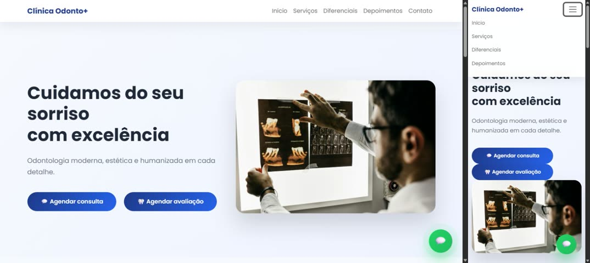

# Clínica Odonto+

Site demonstrativo de uma clínica odontológica. O visitante pode conhecer os serviços, consultar o horário de atendimento e acessar a opção de agendamento pelo WhatsApp. O telefone e o endereço são ilustrativos.

[Abrir a demonstração](https://raw.githack.com/sauloz20/clinica-odontologica/main/index.html) · [Ver o HTML](index.html)

## Como a navegação se adapta

A mesma barra de navegação atende às duas telas. A classe `navbar-expand-lg` do Bootstrap mantém os links visíveis no desktop e os recolhe no celular. O botão do menu expande a navegação sem tirar o visitante da página. As âncoras levam diretamente a serviços, diferenciais, depoimentos e contato.

## Executar localmente

Na raiz do repositório, execute `python -m http.server 8000` e abra [localhost:8000](http://localhost:8000). O site usa HTML, CSS, JavaScript e Bootstrap 5. O carregamento do Bootstrap e das fontes requer internet.
